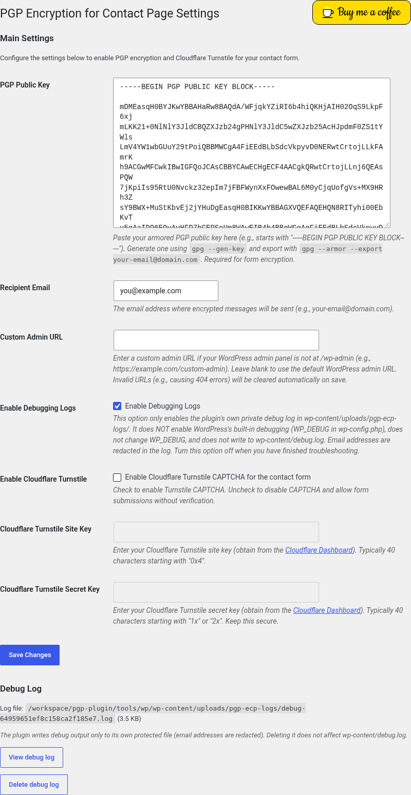

<h1 align="center">PGP Encryption for Contact Page</h1>

<p align="center">
  <strong>A WordPress contact form that PGP-encrypts every message on your server before it is emailed.</strong>
</p>

<p align="center">
  
  
  
  
  <a href="https://buymeacoffee.com/stanghellini"></a>
</p>

---

## Overview

**PGP Encryption for Contact Page** adds a simple contact form to any page or post with a shortcode. When a visitor submits the form, the plugin encrypts the message with **your PGP public key** using the PHP `gnupg` extension, and sends only the encrypted text by email. Only the holder of the matching private key can read it.

Optional **Cloudflare Turnstile** CAPTCHA protects the form from spam. A built-in **private debug log** (with email addresses redacted) helps with troubleshooting.

<p align="center">
   PGP Encryption" width="520">
</p>

## Features

- **Shortcode contact form:** `[pgp_contact_form]` (name, email, subject, message), submitted over AJAX.
- **Public key display:** `[pgp_public_key]` shows your saved public key so visitors can encrypt to you directly.
- **Server-side PGP encryption** with the PHP `gnupg` extension. Each email body is an ASCII-armored PGP message (`-----BEGIN PGP MESSAGE-----`).
- **Key check on save:** the armored public key is validated and test-imported when you save the settings.
- **Optional Cloudflare Turnstile CAPTCHA,** verified on the server.
- **Optional custom admin URL** for sites that move `wp-admin` (used for the AJAX endpoint, with automatic fallback).
- **Private debug log:**
  - written to its own protected file, never to `wp-content/debug.log`;
  - **email addresses are always redacted** (for example `a********@*****.com`) and message contents are never logged;
  - **View** and **Delete** buttons on the settings page, for administrators only.
- **Security:** WordPress nonces, capability checks, input sanitization and output escaping. It passes the WordPress Plugin Check and the WordPress Coding Standards.
- **Translation-ready** (text domain `pgp-encryption-for-contact-page`).
- **Clean uninstall:** removes the plugin's options, transient and log folder.

## How it works

```
Visitor fills in [pgp_contact_form]
        │  AJAX POST (nonce, optional Turnstile token)
        ▼
WordPress (admin-ajax.php)
  1. verify nonce (and the Turnstile token with Cloudflare, if enabled)
  2. sanitize and validate the fields
  3. gnupg: import your public key, encrypt "Name / Email / Subject / Message"
  4. wp_mail() the armored PGP message to your recipient address
        ▼
Your inbox: an encrypted message, decrypted locally with your private key
```

Encryption happens on your server, not in the visitor's browser. No JavaScript crypto library is used. Your private key never touches the site.

## Requirements

| Requirement | Version |
|---|---|
| WordPress | 6.0 or later (tested up to **7.1**) |
| PHP | **7.4** or later (tested up to **8.4**, 8.4.26) |
| PHP extension | `gnupg` (PECL), using the GnuPG library on the server. Tested with gnupg ext 1.5.2, GPGME 1.24.2, GnuPG 2.4.7 |

If `gnupg` is not available, the plugin shows an admin notice and won't activate. Ask your host to enable the extension.

## Installation

1. Download the plugin zip from the [Releases](https://github.com/Aldous-Huxley/PGP-Encryptio-for-Contact-Page/releases) page, or clone this repository into a folder named `pgp-encryption-for-contact-page`.
2. In WordPress, go to **Plugins → Add New → Upload Plugin**, choose the zip, then **Activate**. Alternatively, upload the folder to `/wp-content/plugins/`.
3. Configure it under **Settings → PGP Encryption** (see below).
4. Add `[pgp_contact_form]` to any page or post. Optionally, add `[pgp_public_key]` to publish your public key.

## Configuration

Go to **Settings → PGP Encryption**:

| Setting | Description |
|---|---|
| **PGP Public Key** | Paste your ASCII-armored public key (`-----BEGIN PGP PUBLIC KEY BLOCK-----`). Generate one with `gpg --gen-key` and export it with `gpg --armor --export you@example.com`. Required. |
| **Recipient Email** | The address that receives the encrypted messages. |
| **Custom Admin URL** | Only if your admin isn't at `/wp-admin`. Invalid URLs are cleared on save. |
| **Enable Cloudflare Turnstile** | Turns the CAPTCHA on or off. When on, enter your **Site Key** and **Secret Key** from the [Cloudflare dashboard](https://dash.cloudflare.com/turnstile). |
| **Enable Debugging Logs** | Turns the plugin's own private log on or off (see below). |

### Debug log

- **What it does:** when **Enable Debugging Logs** is checked, the plugin writes troubleshooting messages to `wp-content/uploads/pgp-ecp-logs/debug-<random>.log`.
- **What it does not do:**
  - it does **not** enable WordPress debugging (`WP_DEBUG`) and does not change it;
  - it does **not** write to `wp-content/debug.log`.
- **Privacy:** email addresses are redacted (`a********@*****.com`), and names, subjects and message contents are never logged.
- **View debug log** opens the most recent 500 KB in a new tab (administrators only).
- **Delete debug log** removes the file.
- **Write failures:** if the folder can't be written, the settings page tells you why.
- **When you're done:** turn the option off.

## Shortcodes

| Shortcode | Output |
|---|---|
| `[pgp_contact_form]` | The encrypted contact form. If no public key is configured, it shows a configuration error instead. |
| `[pgp_public_key]` | Your saved ASCII-armored public key in a `<pre>` block (escaped). If no key is saved, it shows "No public key available." |

## Privacy & security

- **End-to-end confidentiality of the message body:** the email contains only PGP ciphertext.
- **No full email addresses in logs:** `pgp_ecp_redact_email()` plus automatic scrubbing of every log line.
- **Private log folder:**
  - the file name is unguessable (derived from your site's secret salts);
  - the folder is protected by `index.php` and a deny-all `.htaccess`;
  - View and Delete require `manage_options` and a nonce.
- **Hardened code:** nonces on the form and admin actions, sanitized input, escaped output, and capability checks.

**Nginx users:** Nginx ignores `.htaccess`. Add a rule like this to your server block:

```nginx
location ^~ /wp-content/uploads/pgp-ecp-logs/ {
    deny all;
    return 404;
}
```

## External services

This plugin can connect to **Cloudflare Turnstile**. This only happens if you enable it in the settings.

- **In the browser:** the Turnstile script `https://challenges.cloudflare.com/turnstile/v0/api.js` is loaded on the front end. Cloudflare requires it to be served from its own servers, so it can't be bundled. The visitor's browser sends data (such as IP address and browser signals) to Cloudflare so it can tell humans from bots.
- **On the server:** on submission, the token and your secret key are sent to `https://challenges.cloudflare.com/turnstile/v0/siteverify`.
- **Cloudflare's terms:** [Terms of Service](https://www.cloudflare.com/website-terms/) · [Privacy Policy](https://www.cloudflare.com/privacypolicy/) · [Turnstile privacy addendum](https://www.cloudflare.com/turnstile-privacy-policy/)

No other remote resources are loaded. The settings page's "Buy me a coffee" button is plain local HTML/CSS with a bundled font.

## FAQ

<details>
<summary><strong>The form says "PGP encryption is not configured properly".</strong></summary>

Save a valid armored public key under **Settings → PGP Encryption**.
</details>

<details>
<summary><strong>Encryption fails or the plugin won't activate.</strong></summary>

The PHP `gnupg` extension is missing. Ask your hosting provider to enable it.
</details>

<details>
<summary><strong>Does it work with other contact form plugins?</strong></summary>

It's a standalone form. Other form plugins aren't officially supported.
</details>

<details>
<summary><strong>I enabled debugging but see no log.</strong></summary>

Look at the **Debug Log** box on the settings page. It shows the file, or the reason it can't be written, such as folder permissions.
</details>

## Changelog

See **[CHANGELOG.md](CHANGELOG.md)**. Highlights of **2.1.0**:
- WordPress Plugin Check: no errors (was 7 readme findings, 4 offloading errors, plus escaping/nonce/text-domain issues).
- WordPress Coding Standards: 0 errors, 0 warnings (was 1,783 errors, 111 warnings).
- A private, redacted debug log with View and Delete.
- GPL-2.0-or-later.
- The `[pgp_public_key]` shortcode is restored.
- A new Buy Me a Coffee link.

## Contributing

Issues and pull requests are welcome. Please:

1. Follow the [WordPress Coding Standards](https://developer.wordpress.org/coding-standards/wordpress-coding-standards/php/). PHPCS with `WordPress` should report 0 issues.
2. Run the official [Plugin Check](https://wordpress.org/plugins/plugin-check/) before submitting.
3. Keep the header comment (`File:` / `Path:`) at the top of every source file.
4. Never log email addresses or message contents. Use `pgp_ecp_log()`, which redacts emails.

## Support the project

If this plugin is useful to you, consider buying me a coffee ☕:

<a href="https://buymeacoffee.com/stanghellini"></a>

## Author

**Robert Stanghellini**: [blockstreamtechnologies.llc](https://blockstreamtechnologies.llc) · WordPress.org: [jwebber74](https://profiles.wordpress.org/jwebber74/)

## License

[GPL-2.0-or-later](LICENSE). Copyright © Robert Stanghellini.
The bundled Cookie font (`assets/fonts/`) is by Ania Kruk, licensed under the [SIL Open Font License 1.1](assets/fonts/Cookie-OFL.txt).
